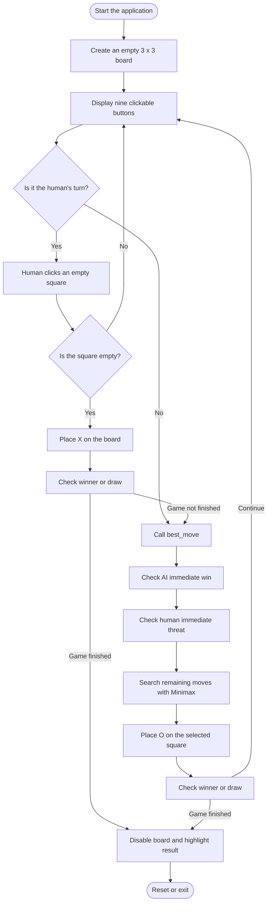
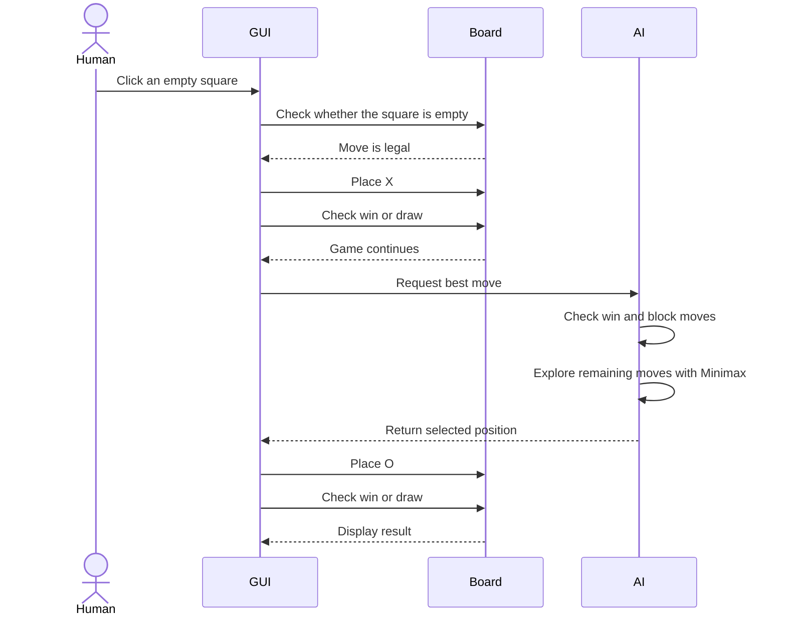
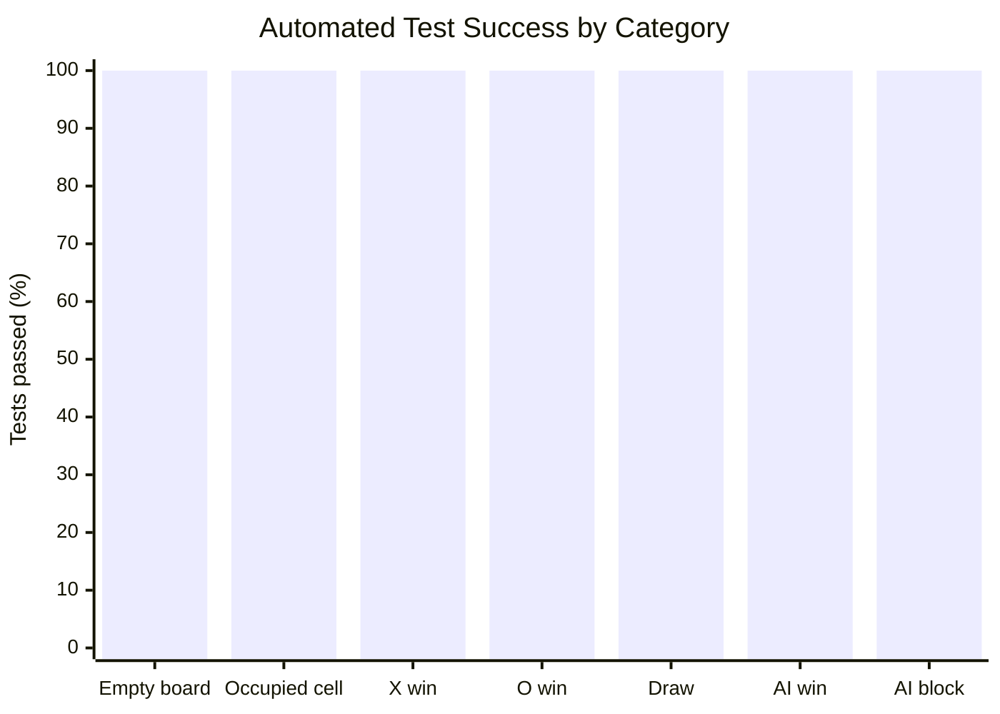

# Tic-Tac-Toe Game

An AI-based graphical Tic-Tac-Toe game developed by **RIDA WAHEED**.

The game is a **Player vs Computer** application. The human plays `X`, while the computer plays `O` using the **Minimax algorithm**.

## Features

- Player vs Computer mode
- Minimax-based AI opponent
- Red `X` and blue `O` colors
- Highlighted winning pattern
- Simple clickable 3 × 3 graphical board
- Human-friendly Tkinter interface

## Project Structure

- `Game.py` - GUI, board logic, win detection, and AI logic
- `test_game.py` - Automated tests for required assignment cases

## How to Run

Make sure Python 3 is installed, then open a terminal in the project folder and run:

```bash
python Game.py
```

## How to Play

1. Click an empty square to place `X`.
2. The AI automatically places `O`.
3. Occupied squares cannot be selected again.
4. Match three symbols in a row, column, or diagonal to win.

## Board and AI

The board is represented as a list of nine strings:

- `"X"` for the human player
- `"O"` for the AI
- `" "` for an empty position

The AI uses the **Minimax algorithm**. It explores possible future moves, gives an AI win a score of `1`, a human win `-1`, and a draw `0`. It then chooses a move with the best possible score. The random choice is used only when several moves have the same best score.

## Code Flow Diagram



### Human and AI Interaction



## Important Code Explained

### 1. Board state and winning combinations

```python
WINNING_LINES = (
    (0, 1, 2), (3, 4, 5), (6, 7, 8),
    (0, 3, 6), (1, 4, 7), (2, 5, 8),
    (0, 4, 8), (2, 4, 6),
)
```

The board is a list with positions `0` to `8`. `WINNING_LINES` contains every row, column, and diagonal that can produce a win.

### 2. Finding the winner

```python
def winner(board):
    for a, b, c in WINNING_LINES:
        if board[a] != " " and board[a] == board[b] == board[c]:
            return board[a], (a, b, c)
    return None
```

This function checks all winning combinations and returns the winning symbol and the three winning positions.

### 3. Finding legal moves

```python
def legal_moves(board):
    return [i for i, value in enumerate(board) if value == " "]
```

Only empty cells are legal moves. This also prevents moves in occupied cells.

### 4. Minimax AI search

```python
def minimax(board, is_ai_turn):
    result = winner(board)
    if result:
        return 1 if result[0] == "O" else -1
    if not legal_moves(board):
        return 0
```

Minimax explores the complete game tree:

- AI win: `1`
- Human win: `-1`
- Draw: `0`
- AI maximizes the score
- Human move is treated as minimizing the AI score

### 5. Immediate win and block

```python
for symbol in ("O", "X"):
    for move in moves:
        board[move] = symbol
        result = winner(board)
        board[move] = " "
        if result and result[0] == symbol:
            return move
```

The AI first checks if it can win. It then checks whether `X` can win and occupies that square to block the threat.

### 6. Human move and occupied-cell protection

```python
if self.game_over or self.board[position] != " ":
    return

self.board[position] = "X"
```

The click is accepted only when the game is active and the selected cell is empty.

### 7. Highlighting the winning pattern

```python
symbol, line = result
for position in line:
    self.buttons[position].config(bg="#ffe066")
```

Only the three positions returned by `winner()` receive the yellow highlight.

## Test Cases

| Test case | Result |
|---|---|
| Empty board | Nine empty cells; human starts |
| Occupied cell | Click is ignored |
| Human completes a line | X wins and the board stops |
| AI completes a line | O wins and the board stops |
| Full board without a line | Draw is displayed |
| AI immediate win | AI chooses the winning cell |
| Human immediate threat | AI blocks the threat |

Run the automated tests with:

```bash
python test_game.py
```

## Test Effectiveness

The automated suite covers every minimum functional requirement and the two important AI scenarios.
Each category below represents the percentage of tests passing in that area.



**Overall result: 7 out of 7 tests passed (100%).**

The bar chart is test-evidence coverage, not an estimate of the AI's chance of winning every human game.
Minimax aims to avoid losses and chooses the strongest available move.

## Author

**RIDA WAHEED**

AI Project

<hr>

